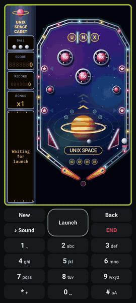
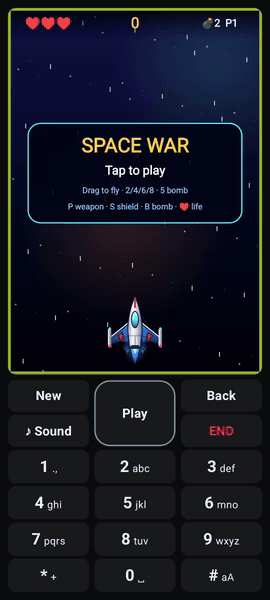
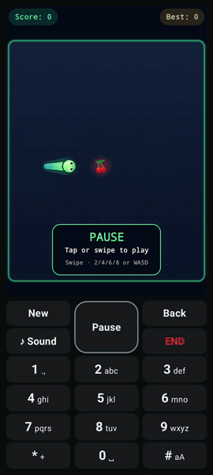
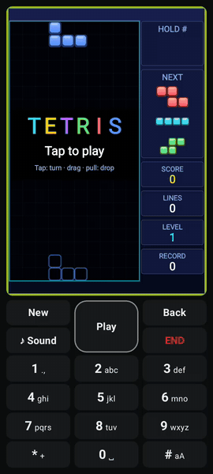
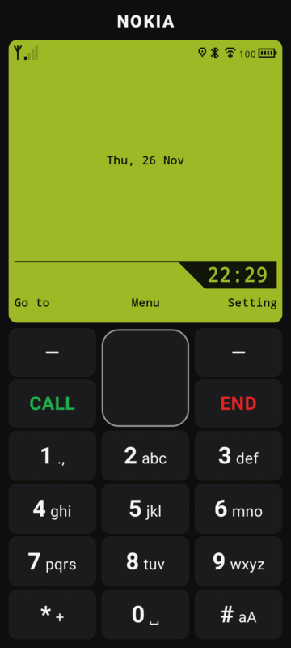
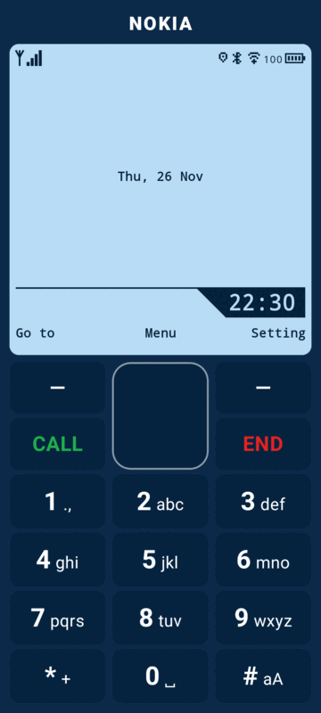
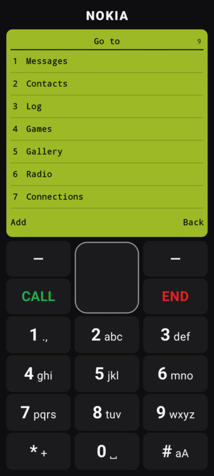
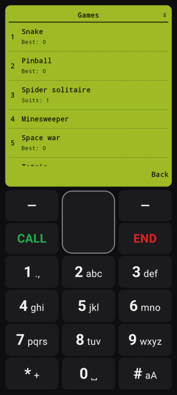
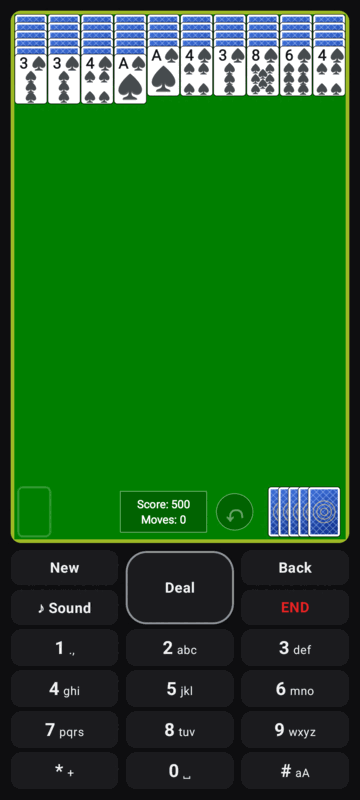
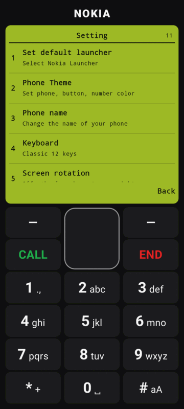

<p align="center">
  <strong>English</strong> ·
  <a href="docs/README_ES.md">Español</a> ·
  <a href="docs/README_IT.md">Italiano</a> ·
  <a href="docs/README_PT.md">Português</a> ·
  <a href="docs/README_FR.md">Français</a> ·
  <a href="docs/README_DE.md">Deutsch</a>
</p>

# Nokia Launcher

A free Android launcher with the look of a classic keypad mobile phone: LCD screen, soft keys, 12-key keypad and its own apps and games.

> Independent fan project, **not an official Nokia product** and not affiliated with or endorsed by Nokia. All brands belong to their owners.

## In motion

<table>
<tr><td></td><td></td><td></td><td></td></tr>
</table>

## Screenshots

<table>
<tr><td></td><td></td><td></td></tr>
</table>

<table>
<tr><td></td><td></td><td></td></tr>
</table>

## Features

- Home screen with clock, real status icons and your notifications
- 12-key keypad with multi-tap typing, or an optional QWERTY keyboard
- 8 color themes, phone name, key tones and vibration
- Grid of your installed apps with search and favorites
- Own messaging, contacts, call log and gallery
- 8 games: Snake, Pinball, Spider solitaire, Minesweeper, Space war, Tetris, Bantumi and Pairs
- Simulated radio, connections panel and secret codes (plus a toy "scanner" that is 100% simulated)
- Keypad lock with `Menu` then `*`
- Works on any screen size, including foldables

## Requirements

Android 12 or later. The app itself is available in **English and Spanish**.

## Install

1. Download the APK from [Releases](../../releases).
2. Open it on your phone and allow installing apps from that source.
3. Open the app and, if you want it as your home screen, go to `Setting` → `Set default launcher`.
4. If Android shows **Restricted setting** when enabling notification access or the lock service: open the app info, tap `⋮` → `Allow restricted settings`, and try again.

The keypad lock prevents accidental presses; it is not a security feature. Android's own screen lock does that.

## Permissions

The sensitive permissions are **optional**: each one is requested only when you use that feature, and the launcher keeps working if you say no.

| For | What it is used for |
|---|---|
| Contacts, SMS, call log, phone | Built-in contacts, messaging, log and calls. It always asks before sending an SMS; emergency numbers go to the system dialer. |
| Photos | Built-in gallery. |
| Notification access | Showing your notifications on the home screen. |
| Accessibility service | Only to turn the screen off when locking. It does not read the screen. |
| Phone state, Bluetooth, Do Not Disturb, system settings | Dual SIM icons and the connections panel (profiles, brightness, rotation, Bluetooth). |
| Vibration, network state | Key vibration and the Wi-Fi icon. |

## Privacy

The app **does not request internet access**: no ads, no analytics, no accounts. Notifications are kept in memory only, are never saved or sent, and are not shown while the phone is locked.

## Build from source

Needs a JDK and the Android SDK (Android Studio includes both).

```bash
./gradlew assembleDebug testDebugUnitTest
```

## Author

Neftalí Angeles Montaño

## License

[BSD 3-Clause](LICENSE)
