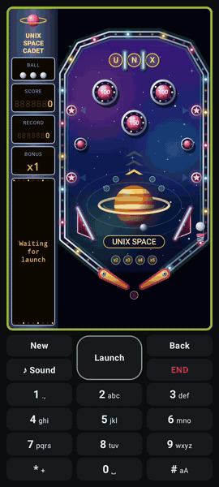
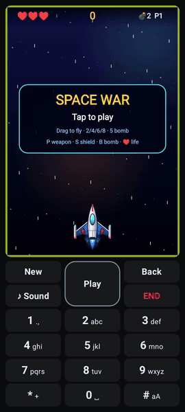
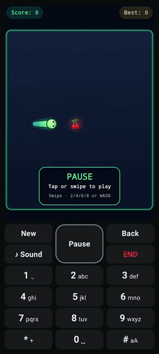
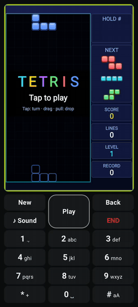
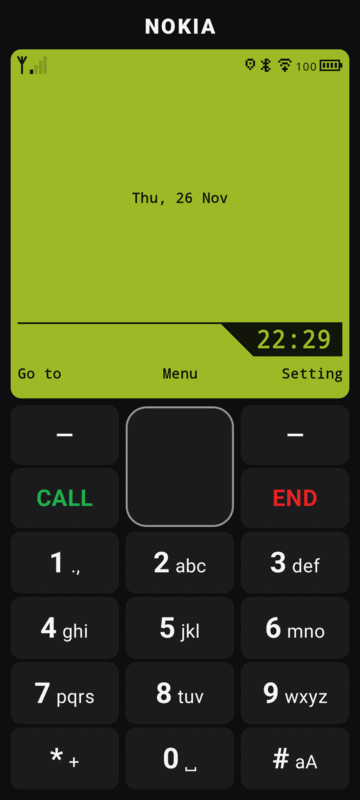
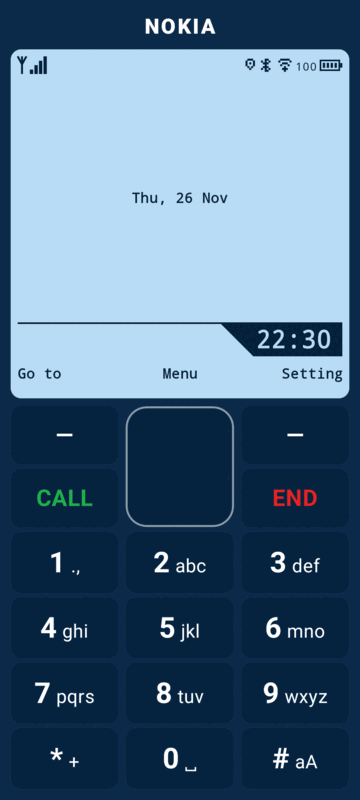
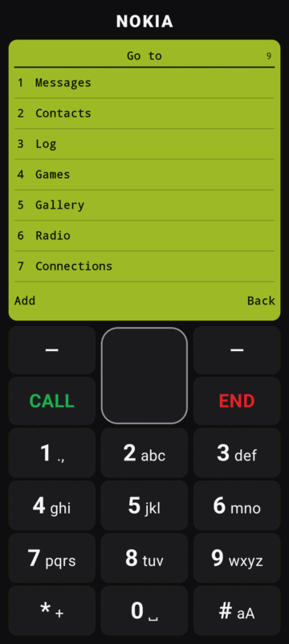
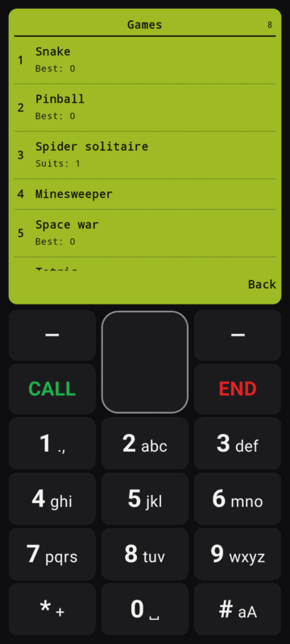
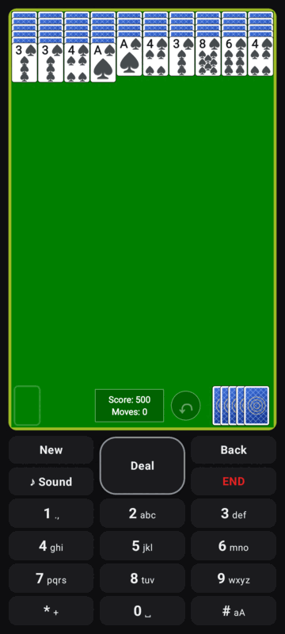
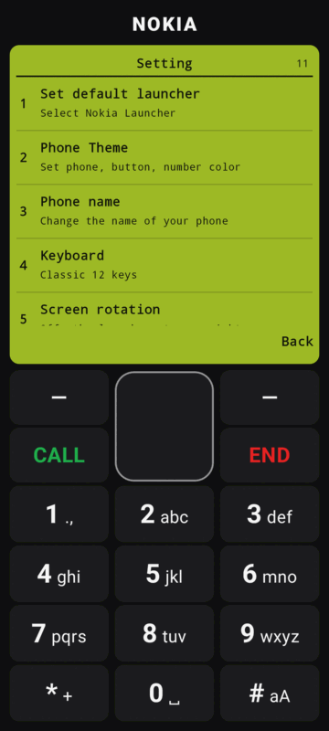

<p align="center">
  <a href="../README.md">English</a> ·
  <a href="README_ES.md">Español</a> ·
  <a href="README_IT.md">Italiano</a> ·
  <a href="README_PT.md">Português</a> ·
  <a href="README_FR.md">Français</a> ·
  <strong>Deutsch</strong>
</p>

# Nokia Launcher

Ein kostenloser Android-Launcher im Stil eines klassischen Tastenhandys: LCD-Anzeige, Softkeys, 12er-Tastenfeld und eigene Apps und Spiele.

> Unabhängiges Fanprojekt: **kein offizielles Nokia-Produkt**, weder mit Nokia verbunden noch von Nokia unterstützt. Alle Marken gehören ihren Inhabern.

## In Bewegung

<table>
<tr><td></td><td></td><td></td><td></td></tr>
</table>

## Screenshots

<table>
<tr><td></td><td></td><td></td></tr>
</table>

<table>
<tr><td></td><td></td><td></td></tr>
</table>

## Funktionen

- Startbildschirm mit Uhr, echten Statussymbolen und Benachrichtigungen
- 12er-Tastenfeld mit Multi-Tap-Eingabe oder optional eine QWERTY-Tastatur
- 8 Farbthemen, Telefonname, Tastentöne und Vibration
- Raster deiner installierten Apps mit Suche und Favoriten
- Eigene Nachrichten, Kontakte, Anrufliste und Galerie
- 8 Spiele: Snake, Pinball, Spider-Solitär, Minesweeper, Weltraumkampf, Tetris, Bantumi und Paare
- Simuliertes Radio, Verbindungsmenü und Geheimcodes (samt vollständig simuliertem Spielzeug-„Scanner“)
- Tastensperre mit `Menu` und dann `*`
- Passt sich jeder Bildschirmgröße an, auch Foldables

## Voraussetzungen

Android 12 oder neuer. Die App selbst gibt es auf **Englisch und Spanisch**.

## Installation

1. Lade die APK unter [Releases](../../../releases) herunter.
2. Öffne sie auf dem Telefon und erlaube die Installation aus dieser Quelle.
3. Öffne die App und wähle, wenn du sie als Startbildschirm nutzen willst, `Setting` → `Set default launcher`.
4. Zeigt Android **Eingeschränkte Einstellung**, wenn du den Benachrichtigungszugriff oder den Sperrdienst aktivierst: Öffne die App-Info, tippe auf `⋮`, erlaube eingeschränkte Einstellungen und versuche es erneut.

Die Tastensperre verhindert versehentliche Eingaben; sie ist kein Sicherheitsmerkmal. Dafür ist die Bildschirmsperre von Android da.

## Berechtigungen

Die sensiblen Berechtigungen sind **freiwillig**: Jede wird erst angefragt, wenn du die Funktion nutzt, und der Launcher läuft auch, wenn du ablehnst.

| Berechtigung | Wofür |
|---|---|
| Kontakte, SMS, Anrufliste, Telefon | Eigene Kontakte, Nachrichten, Anrufliste und Anrufe. Vor jedem SMS-Versand wird nachgefragt; Notrufnummern gehen an die System-Telefon-App. |
| Fotos | Eigene Galerie. |
| Benachrichtigungszugriff | Benachrichtigungen auf dem Startbildschirm anzeigen. |
| Bedienungshilfe-Dienst | Nur um beim Sperren den Bildschirm auszuschalten. Er liest den Bildschirm nicht. |
| Telefonstatus, Bluetooth, Nicht stören, Systemeinstellungen | Dual-SIM-Symbole und Verbindungsmenü (Profile, Helligkeit, Drehung, Bluetooth). |
| Vibration, Netzwerkstatus | Tastenvibration und WLAN-Symbol. |

## Datenschutz

Die App **verlangt keinen Internetzugriff**: keine Werbung, keine Analyse, keine Konten. Benachrichtigungen bleiben nur im Arbeitsspeicher, werden weder gespeichert noch gesendet und erscheinen nicht bei gesperrtem Telefon.

## Aus dem Quellcode bauen

Benötigt ein JDK und das Android SDK (Android Studio enthält beides).

```bash
./gradlew assembleDebug testDebugUnitTest
```

## Autor

Neftalí Angeles Montaño

## Lizenz

[BSD 3-Clause](../LICENSE)
