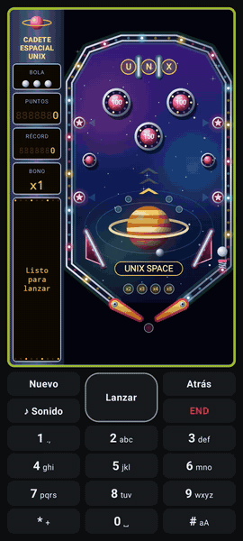
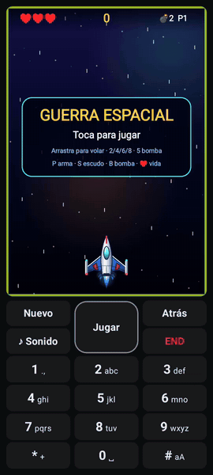
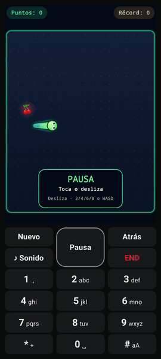
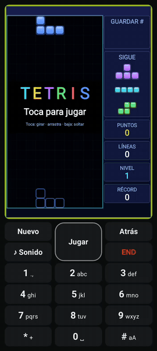
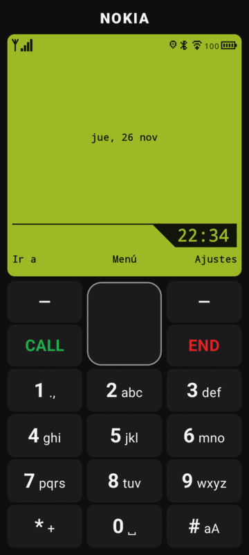
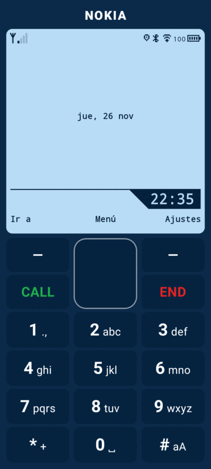
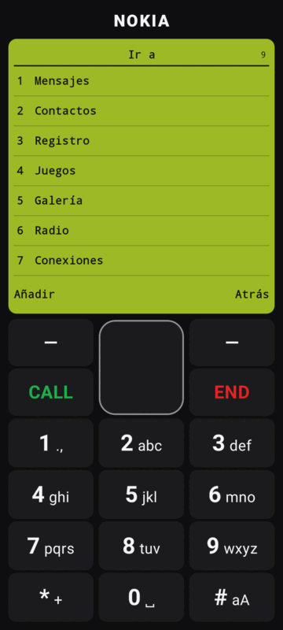
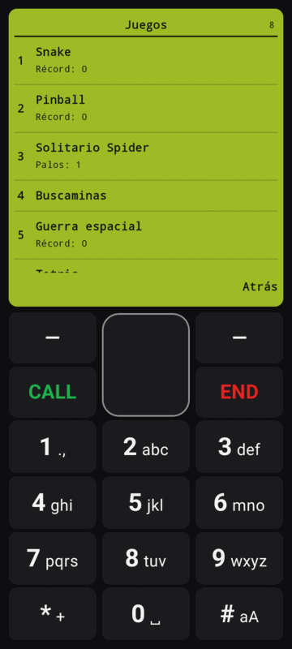
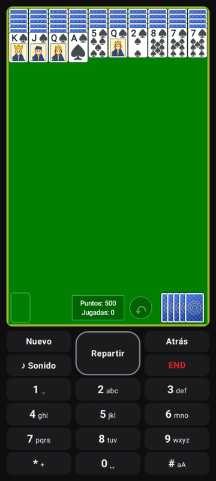
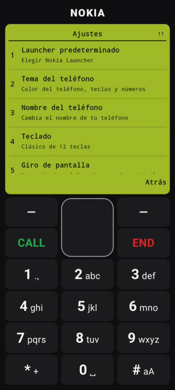

<p align="center">
  <a href="../README.md">English</a> ·
  <strong>Español</strong> ·
  <a href="README_IT.md">Italiano</a> ·
  <a href="README_PT.md">Português</a> ·
  <a href="README_FR.md">Français</a> ·
  <a href="README_DE.md">Deutsch</a>
</p>

# Nokia Launcher

Un launcher gratuito para Android con el aspecto de un móvil clásico de teclas: pantalla LCD, teclas blandas, teclado de 12 teclas y apps y juegos propios.

> Proyecto independiente de aficionado: **no es un producto oficial de Nokia** ni está afiliado ni avalado por Nokia. Las marcas son de sus dueños.

## En movimiento

<table>
<tr><td></td><td></td><td></td><td></td></tr>
</table>

## Pantallas

<table>
<tr><td></td><td></td><td></td></tr>
</table>

<table>
<tr><td></td><td></td><td></td></tr>
</table>

## Funciones

- Inicio con reloj, iconos de estado reales y tus notificaciones
- Teclado de 12 teclas con escritura multi-tap, o teclado QWERTY opcional
- 8 temas de color, nombre del teléfono, tonos y vibración de teclas
- Rejilla de tus apps instaladas con buscador y favoritas
- Mensajes, contactos, registro de llamadas y galería propios
- 8 juegos: Snake, Pinball, Solitario Spider, Buscaminas, Guerra espacial, Tetris, Bantumi y Parejas
- Radio simulada, panel de conexiones y códigos secretos (con un «escáner» de juguete 100 % simulado)
- Bloqueo de teclado con `Menú` y luego `*`
- Se adapta a cualquier pantalla, también plegables

## Requisitos

Android 12 o posterior. La app está disponible en **inglés y español**.

## Instalación

1. Descarga el APK desde [Releases](../../../releases).
2. Ábrelo en tu teléfono y permite instalar apps de ese origen.
3. Abre la app y, si la quieres como pantalla de inicio, entra en `Ajustes` → `Launcher predeterminado`.
4. Si Android muestra **Ajuste restringido** al activar el acceso a notificaciones o el servicio de bloqueo: abre la información de la app, toca `⋮` → `Permitir ajustes restringidos` y vuelve a intentarlo.

El bloqueo de teclado evita pulsaciones accidentales; no es una medida de seguridad. De eso se encarga el bloqueo de Android.

## Permisos

Los permisos delicados son **opcionales**: cada uno se pide solo al usar esa función, y el launcher sigue funcionando si dices que no.

| Permiso | Para qué se usa |
|---|---|
| Contactos, SMS, registro de llamadas, teléfono | Contactos, mensajes, registro y llamadas propios. Siempre pregunta antes de enviar un SMS; los números de emergencia pasan al marcador del sistema. |
| Fotos | Galería propia. |
| Acceso a notificaciones | Mostrar tus avisos en la pantalla de inicio. |
| Servicio de accesibilidad | Solo para apagar la pantalla al bloquear. No lee la pantalla. |
| Estado del teléfono, Bluetooth, No molestar, ajustes del sistema | Iconos de dos SIM y panel de conexiones (perfiles, brillo, giro, Bluetooth). |
| Vibración, estado de la red | Vibración de las teclas e icono de Wi-Fi. |

## Privacidad

La app **no pide acceso a internet**: sin anuncios, sin analítica y sin cuentas. Las notificaciones solo viven en memoria, no se guardan ni se envían, y no aparecen con el teléfono bloqueado.

## Compilar el código

Necesita un JDK y el SDK de Android (Android Studio incluye ambos).

```bash
./gradlew assembleDebug testDebugUnitTest
```

## Autor

Neftalí Angeles Montaño

## Licencia

[BSD 3-Clause](../LICENSE)
