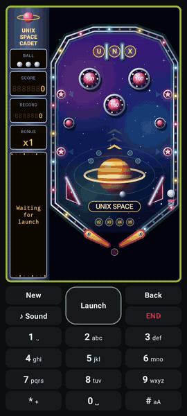
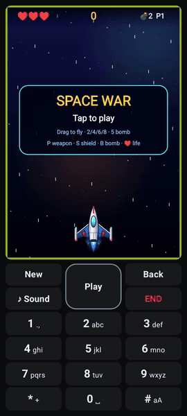
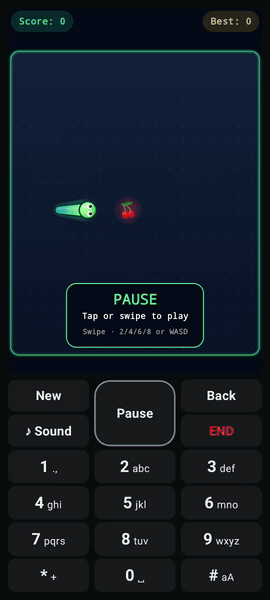
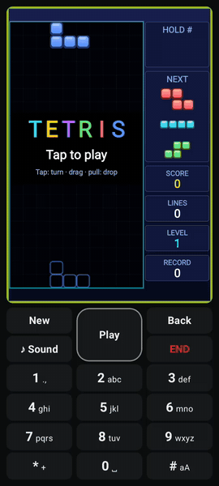
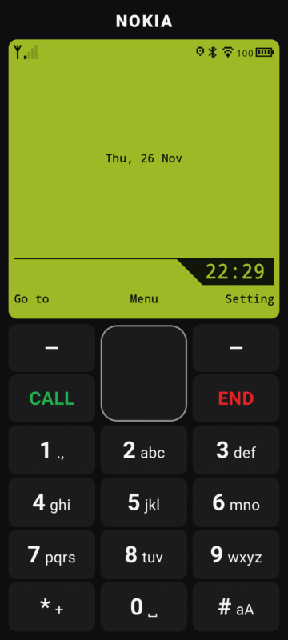
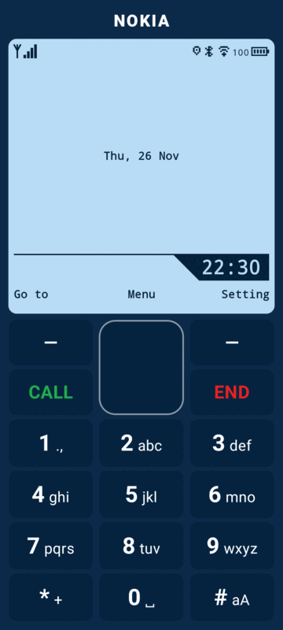
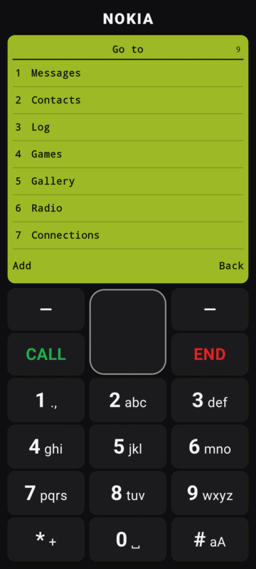
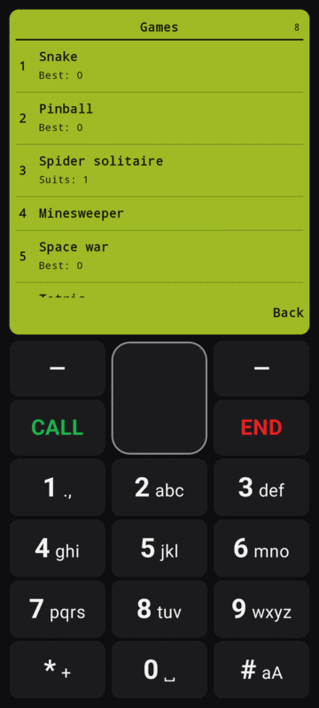
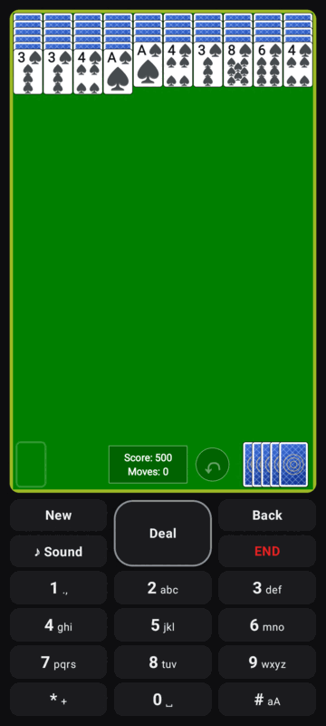
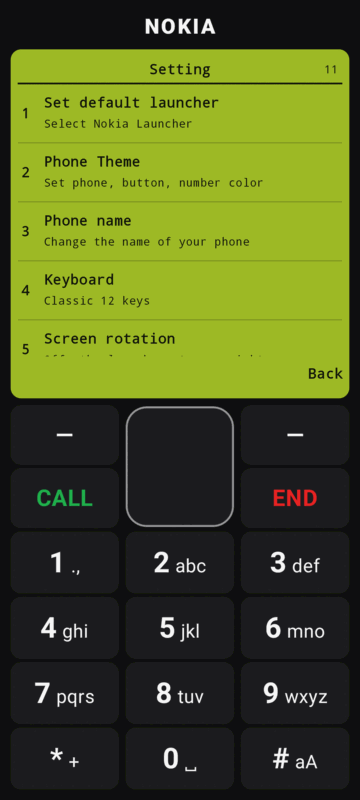

<p align="center">
  <a href="../README.md">English</a> ·
  <a href="README_ES.md">Español</a> ·
  <a href="README_IT.md">Italiano</a> ·
  <a href="README_PT.md">Português</a> ·
  <strong>Français</strong> ·
  <a href="README_DE.md">Deutsch</a>
</p>

# Nokia Launcher

Un launcher Android gratuit au style d'un téléphone à touches classique : écran LCD, touches contextuelles, clavier à 12 touches, applications et jeux intégrés.

> Projet indépendant réalisé par un passionné : **ce n'est pas un produit officiel Nokia**, il n'est ni affilié à Nokia ni approuvé par Nokia. Les marques appartiennent à leurs propriétaires.

## En mouvement

<table>
<tr><td></td><td></td><td></td><td></td></tr>
</table>

## Captures d'écran

<table>
<tr><td></td><td></td><td></td></tr>
</table>

<table>
<tr><td></td><td></td><td></td></tr>
</table>

## Fonctions

- Écran d'accueil avec horloge, icônes d'état réelles et notifications
- Clavier à 12 touches avec saisie multi-tap, ou clavier QWERTY en option
- 8 thèmes de couleur, nom du téléphone, sons et vibration des touches
- Grille de vos applications avec recherche et favoris
- Messages, contacts, journal d'appels et galerie intégrés
- 8 jeux : Snake, Pinball, Solitaire Spider, Démineur, Guerre spatiale, Tetris, Bantumi et Paires
- Radio simulée, panneau des connexions et codes secrets (avec un « scanner » jouet entièrement simulé)
- Verrouillage du clavier avec `Menu` puis `*`
- S'adapte à toutes les tailles d'écran, y compris les pliables

## Configuration requise

Android 12 ou version ultérieure. L'application est disponible en **anglais et en espagnol**.

## Installation

1. Téléchargez l'APK depuis [Releases](../../../releases).
2. Ouvrez-le sur votre téléphone et autorisez l'installation depuis cette source.
3. Ouvrez l'application et, pour l'utiliser comme écran d'accueil, allez dans `Setting` → `Set default launcher`.
4. Si Android affiche **Paramètre restreint** lors de l'activation de l'accès aux notifications ou du service de verrouillage : ouvrez les informations de l'application, touchez `⋮`, autorisez les paramètres restreints et réessayez.

Le verrouillage du clavier évite les appuis accidentels ; ce n'est pas une protection. C'est le rôle du verrouillage d'écran d'Android.

## Autorisations

Les autorisations sensibles sont **facultatives** : chacune n'est demandée qu'au moment d'utiliser la fonction, et le launcher continue de marcher si vous refusez.

| Autorisation | Utilité |
|---|---|
| Contacts, SMS, journal d'appels, téléphone | Contacts, messages, journal et appels intégrés. Une confirmation est toujours demandée avant d'envoyer un SMS ; les numéros d'urgence passent par le clavier du système. |
| Photos | Galerie intégrée. |
| Accès aux notifications | Afficher vos notifications sur l'écran d'accueil. |
| Service d'accessibilité | Uniquement pour éteindre l'écran au verrouillage. Il ne lit pas l'écran. |
| État du téléphone, Bluetooth, Ne pas déranger, paramètres système | Icônes double SIM et panneau des connexions (profils, luminosité, rotation, Bluetooth). |
| Vibreur, état du réseau | Vibration des touches et icône Wi-Fi. |

## Confidentialité

L'application **ne demande pas l'accès à internet** : ni publicité, ni statistiques, ni compte. Les notifications restent uniquement en mémoire, ne sont ni enregistrées ni envoyées et n'apparaissent pas quand le téléphone est verrouillé.

## Compiler le code

Nécessite un JDK et le SDK Android (Android Studio inclut les deux).

```bash
./gradlew assembleDebug testDebugUnitTest
```

## Auteur

Neftalí Angeles Montaño

## Licence

[BSD 3-Clause](../LICENSE)
