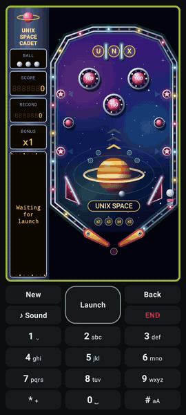
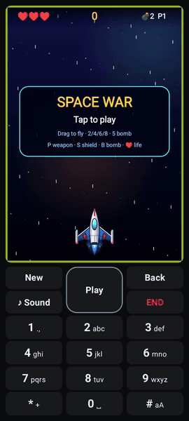
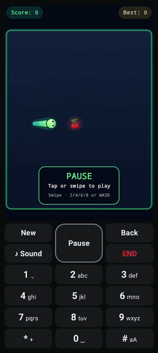
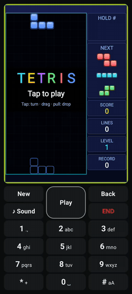
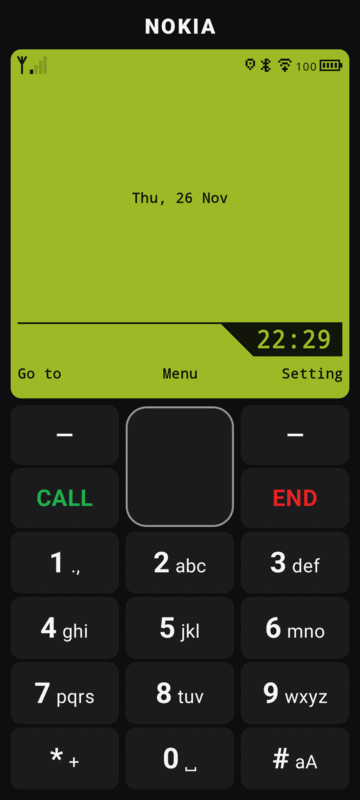
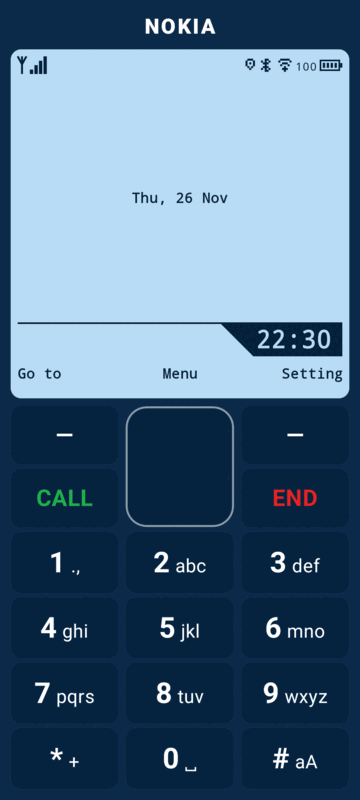
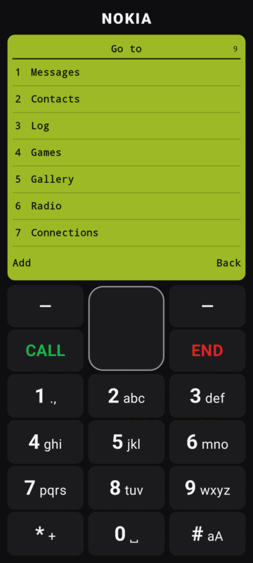
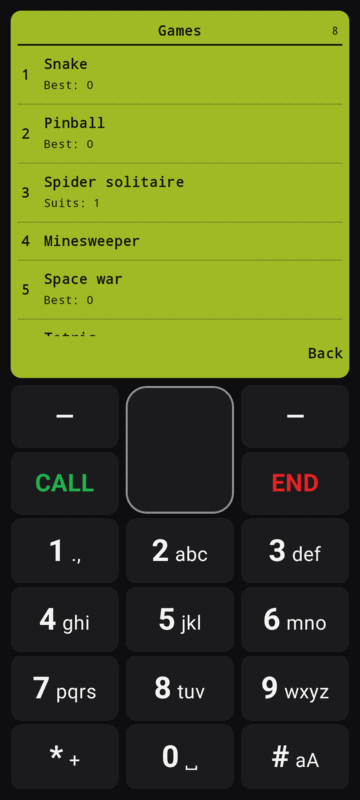
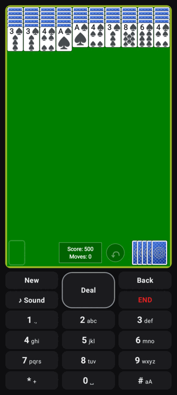
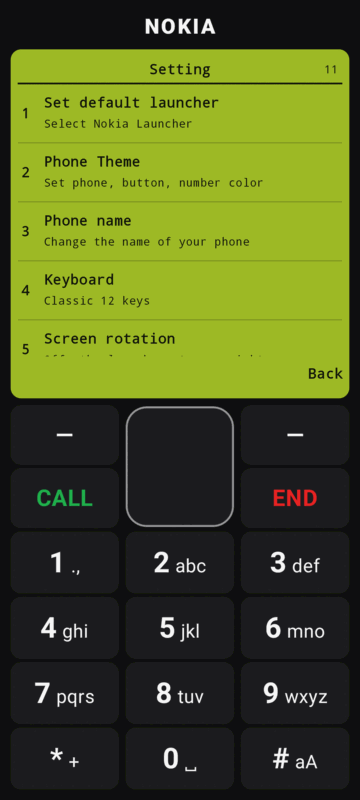

<p align="center">
  <a href="../README.md">English</a> ·
  <a href="README_ES.md">Español</a> ·
  <strong>Italiano</strong> ·
  <a href="README_PT.md">Português</a> ·
  <a href="README_FR.md">Français</a> ·
  <a href="README_DE.md">Deutsch</a>
</p>

# Nokia Launcher

Un launcher Android gratuito con l'aspetto di un classico cellulare a tasti: schermo LCD, tasti funzione, tastierino a 12 tasti, app e giochi propri.

> Progetto indipendente di un appassionato: **non è un prodotto ufficiale Nokia** e non è affiliato né approvato da Nokia. I marchi appartengono ai rispettivi proprietari.

## In movimento

<table>
<tr><td></td><td></td><td></td><td></td></tr>
</table>

## Schermate

<table>
<tr><td></td><td></td><td></td></tr>
</table>

<table>
<tr><td></td><td></td><td></td></tr>
</table>

## Funzioni

- Schermata Home con orologio, icone di stato reali e notifiche
- Tastierino a 12 tasti con scrittura multi-tap, o tastiera QWERTY facoltativa
- 8 temi a colori, nome del telefono, toni e vibrazione dei tasti
- Griglia delle app installate con ricerca e preferite
- Messaggi, contatti, registro chiamate e galleria propri
- 8 giochi: Snake, Pinball, Solitario Spider, Campo minato, Guerra spaziale, Tetris, Bantumi e Coppie
- Radio simulata, pannello connessioni e codici segreti (con uno «scanner» giocattolo completamente simulato)
- Blocco tastiera con `Menu` e poi `*`
- Si adatta a qualsiasi schermo, anche pieghevole

## Requisiti

Android 12 o successivo. L'app è disponibile in **inglese e spagnolo**.

## Installazione

1. Scarica l'APK da [Releases](../../../releases).
2. Aprilo sul telefono e consenti l'installazione di app da quella fonte.
3. Apri l'app e, se la vuoi come schermata Home, vai in `Setting` → `Set default launcher`.
4. Se Android mostra **Impostazione con limitazioni** quando attivi l'accesso alle notifiche o il servizio di blocco: apri le informazioni sull'app, tocca `⋮`, consenti le impostazioni con limitazioni e riprova.

Il blocco tastiera evita pressioni accidentali; non è una funzione di sicurezza. A quella pensa il blocco schermo di Android.

## Autorizzazioni

Le autorizzazioni sensibili sono **facoltative**: ognuna viene richiesta solo quando usi quella funzione, e il launcher continua a funzionare se rifiuti.

| Autorizzazione | A cosa serve |
|---|---|
| Contatti, SMS, registro chiamate, telefono | Contatti, messaggi, registro e chiamate integrati. Chiede sempre conferma prima di inviare un SMS; i numeri di emergenza passano al tastierino di sistema. |
| Foto | Galleria integrata. |
| Accesso alle notifiche | Mostrare le notifiche nella schermata Home. |
| Servizio di accessibilità | Solo per spegnere lo schermo quando si blocca. Non legge lo schermo. |
| Stato del telefono, Bluetooth, Non disturbare, impostazioni di sistema | Icone dual SIM e pannello connessioni (profili, luminosità, rotazione, Bluetooth). |
| Vibrazione, stato della rete | Vibrazione dei tasti e icona Wi-Fi. |

## Privacy

L'app **non richiede l'accesso a internet**: niente pubblicità, analisi o account. Le notifiche restano solo in memoria, non vengono salvate né inviate e non compaiono a telefono bloccato.

## Compilare il codice

Servono un JDK e l'SDK di Android (Android Studio li include entrambi).

```bash
./gradlew assembleDebug testDebugUnitTest
```

## Autore

Neftalí Angeles Montaño

## Licenza

[BSD 3-Clause](../LICENSE)
