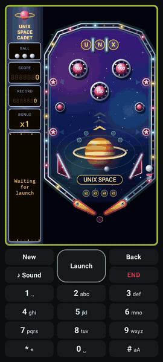
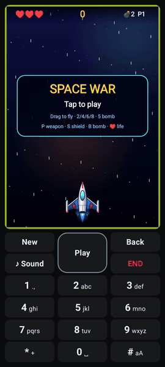
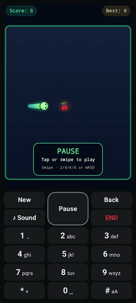
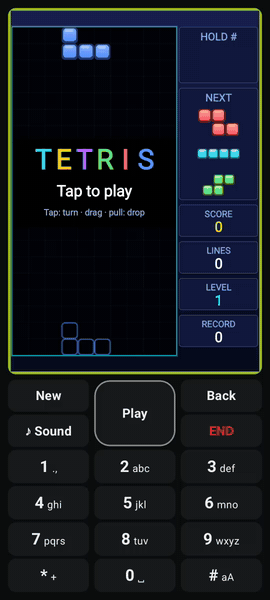
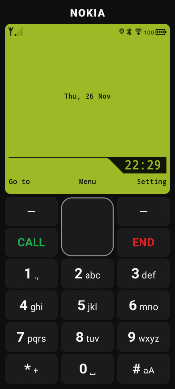
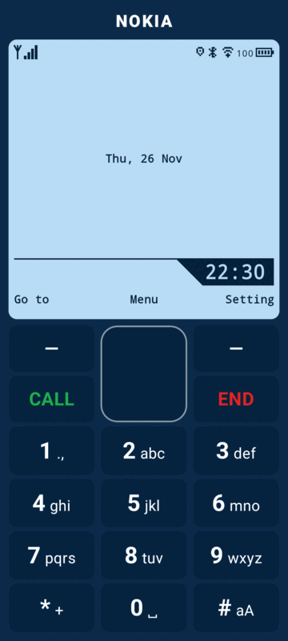
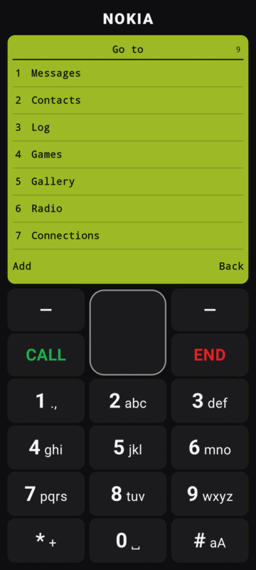
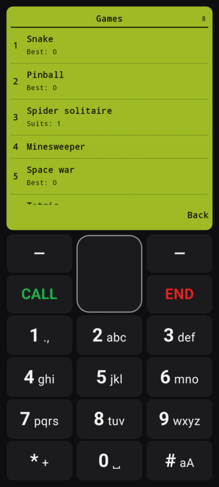
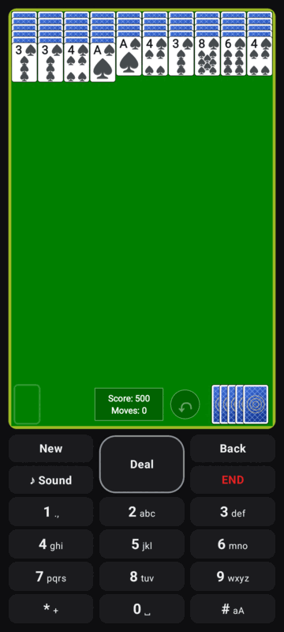
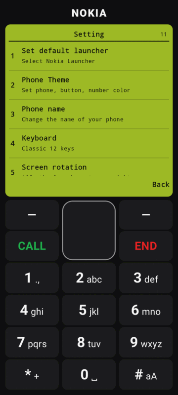

<p align="center">
  <a href="../README.md">English</a> ·
  <a href="README_ES.md">Español</a> ·
  <a href="README_IT.md">Italiano</a> ·
  <strong>Português</strong> ·
  <a href="README_FR.md">Français</a> ·
  <a href="README_DE.md">Deutsch</a>
</p>

# Nokia Launcher

Um launcher gratuito para Android com a aparência de um celular clássico de teclas: tela LCD, teclas de função, teclado de 12 teclas e apps e jogos próprios.

> Projeto independente feito por um fã: **não é um produto oficial da Nokia** e não é afiliado nem aprovado pela Nokia. As marcas pertencem aos seus donos.

## Em movimento

<table>
<tr><td></td><td></td><td></td><td></td></tr>
</table>

## Capturas de tela

<table>
<tr><td></td><td></td><td></td></tr>
</table>

<table>
<tr><td></td><td></td><td></td></tr>
</table>

## Recursos

- Tela inicial com relógio, ícones de status reais e suas notificações
- Teclado de 12 teclas com digitação multi-toque, ou teclado QWERTY opcional
- 8 temas de cores, nome do telefone, sons e vibração das teclas
- Grade dos apps instalados com busca e favoritos
- Mensagens, contatos, registro de chamadas e galeria próprios
- 8 jogos: Snake, Pinball, Paciência Spider, Campo Minado, Guerra espacial, Tetris, Bantumi e Pares
- Rádio simulado, painel de conexões e códigos secretos (com um «scanner» de brinquedo totalmente simulado)
- Bloqueio de teclado com `Menu` e depois `*`
- Funciona em qualquer tamanho de tela, inclusive dobráveis

## Requisitos

Android 12 ou superior. O app está disponível em **inglês e espanhol**.

## Instalação

1. Baixe o APK em [Releases](../../../releases).
2. Abra-o no telefone e permita instalar apps dessa fonte.
3. Abra o app e, se quiser usá-lo como tela inicial, vá em `Setting` → `Set default launcher`.
4. Se o Android mostrar **Configuração restrita** ao ativar o acesso às notificações ou o serviço de bloqueio: abra as informações do app, toque em `⋮`, permita as configurações restritas e tente de novo.

O bloqueio de teclado evita toques acidentais; não é um recurso de segurança. Disso cuida o bloqueio de tela do Android.

## Permissões

As permissões sensíveis são **opcionais**: cada uma é pedida só quando você usa a função, e o launcher continua funcionando se você recusar.

| Permissão | Para que serve |
|---|---|
| Contatos, SMS, registro de chamadas, telefone | Contatos, mensagens, registro e chamadas próprios. Sempre pergunta antes de enviar um SMS; números de emergência vão para o discador do sistema. |
| Fotos | Galeria própria. |
| Acesso às notificações | Mostrar suas notificações na tela inicial. |
| Serviço de acessibilidade | Apenas para desligar a tela ao bloquear. Não lê a tela. |
| Estado do telefone, Bluetooth, Não perturbe, configurações do sistema | Ícones de dois chips e painel de conexões (perfis, brilho, rotação, Bluetooth). |
| Vibração, estado da rede | Vibração das teclas e ícone de Wi-Fi. |

## Privacidade

O app **não pede acesso à internet**: sem anúncios, análises ou contas. As notificações ficam apenas na memória, não são salvas nem enviadas e não aparecem com o telefone bloqueado.

## Compilar o código

Requer um JDK e o SDK do Android (o Android Studio inclui os dois).

```bash
./gradlew assembleDebug testDebugUnitTest
```

## Autor

Neftalí Angeles Montaño

## Licença

[BSD 3-Clause](../LICENSE)
